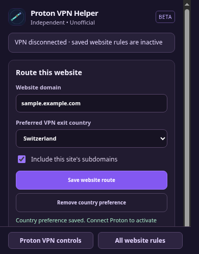
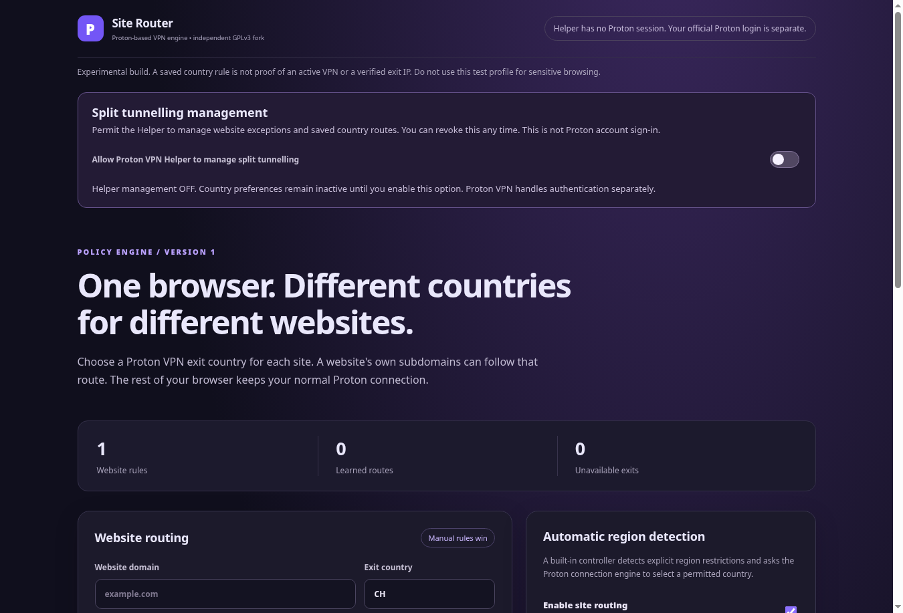

# Proton VPN Helper

**Choose a preferred Proton VPN country for each website, without constantly changing the VPN country for your whole browser.**

An independent, open-source modification of [Proton VPN's browser extension](https://github.com/ProtonVPN/proton-vpn-browser-extension). **Unofficial — not affiliated with or endorsed by Proton.**

> **Developer preview — not ready for everyday VPN use.** The settings interface, saved rules and local policy sync have passed automated browser tests. Signing in to Proton with this modified extension, routing real traffic through different countries, and preventing network leaks have **not** been verified. Do not replace your trusted VPN setup with this build yet.

## The problem

Imagine you normally use a UK VPN server, but one website is only available through a Netherlands exit and another works best through Switzerland.

With the usual browser VPN controls, you have to change the active country when you change websites, then remember to change it back. Conventional split tunnelling can include or exclude websites from the VPN, but it does **not** assign a different VPN country to each website.

**Proton VPN Helper is intended to remove that repeated manual switching.** Give a website a country once; the helper remembers the preference while Proton remains responsible for the actual VPN connection.

## How it should work

| Website | Intended VPN exit |
| --- | --- |
| Anything without a rule | Your normal Proton-selected country |
| `sample.example.com` | Switzerland (`CH`) |
| `news.example.org` | Netherlands (`NL`) |

These are **illustrative routing preferences**, not claims that those exit IPs have been observed in live traffic.

The helper is designed to make three things possible: save a country per website, optionally recognise an explicit geographical restriction and try an eligible alternative, then remember an apparently successful route for next time. Manually saved rules take priority. Detection and automatic switching are **off by default**.

Proton's existing engine remains responsible for authentication, server eligibility, connections and browser proxy settings. This is **one modified extension**, not a second extension fighting Proton for proxy control.

## Using your existing official Proton account

**Signing into Proton VPN's official Brave extension does not sign the Helper in.** The two browser extensions have separate storage and authentication. Proton's official extension currently permits external messaging from the Proton account website, **not from this independent Helper extension**. The Helper therefore cannot automatically read the official account session, its subscription or its live country list, and must not attempt to copy private tokens.

If you are already signed into official Proton, the Helper now says **"Helper has no Proton session. Your official Proton login is separate."** rather than incorrectly claiming your entire VPN is disconnected. If another extension controls the browser proxy, it reports that separately without asserting whose account owns it. The original Proton connection remains authoritative.

An authorised integration exposed by Proton, or signing into the fork separately using Proton's user-driven account flow, is required before the Helper can actually load subscription-entitled countries or perform authenticated country routing. **Neither route has been verified for this fork.**

## Proton countries and real connection evidence

The Helper now uses **Proton's own live server catalogue**, including country names and the original flag SVGs, rather than a hard-coded list of destinations. Once signed into Proton, the list reflects which countries the subscription can actually use; locked and unavailable countries are identified but cannot be selected.

The browser proxy and Proton account/session are checked automatically while Chromium is running. A separate **Check default VPN exit IP** control can ask country.is for the visible public IP and country. Optional recurring checks every five minutes are **off by default** because country.is will receive that request's public IP. A match alone is not proof that every website, DNS request or WebRTC connection uses Proton.


*Real browser screenshot, not a mock-up. The country list is correctly empty while signed out; no authenticated Proton country-routing result has been verified yet.* See [connection verification and remaining proof obligations](docs/CONNECTION_VERIFICATION.md).

## The toolbar shortcut (developer preview)



*Real Chromium screenshot, not a mock-up or proof of a Swiss exit IP.*

**First-time setup — before Proton sign-in:** Open **All website rules** from the Helper toolbar, or choose **Configure Helper split tunnelling** on its Proton sign-in screen. Use **Allow Proton VPN Helper to manage split tunnelling** at the top of the settings page. You can also access the same switch in **Proton VPN controls → Settings → Split tunnelling** once signed in. It starts **off** and is a local, reversible permission; without it the Helper cannot change split-tunnelling exceptions, apply per-site country routing or retry countries automatically. The two views mirror permission and rule changes in both directions. [Consent and Proton account walkthrough](docs/CONSENT_AND_ACCOUNT.md).

This consent **does not sign into Proton or share the official extension's private account session**. Use Proton's own account sign-in within the unofficial combined extension; authentication with its independent extension ID is still unverified.

For a website you are viewing, click the **Proton VPN Helper** icon in your browser toolbar (pin it through the Extensions/puzzle-piece menu if hidden), or use **Alt+Shift+Y**. If the shortcut conflicts with another extension, change it under `brave://extensions/shortcuts` or `chrome://extensions/shortcuts`.

The popup reads the current website automatically and lets you choose a country. **Save website route** remembers the choice; **Remove country preference** returns to your existing Proton routing settings. **Proton VPN controls** opens the original connection and split-tunnelling interface, while **All website rules** opens the full rule manager.

If Proton already **excludes** the exact website, the save button explicitly offers to move it into VPN country routing in the same click. It does **not** delete broader parent-domain exclusions, which may affect other websites. If Proton uses **Include-only** mode, the button can add the exact site to that mode when you save a country. Automatic block detection and country retry require separate opt-in.

**Important:** Saving a country rule does not reconnect a disconnected VPN, inherit your official extension's login, or guarantee the country of the resulting traffic. An available server and authenticated live VPN must still be verified.

## Try the working settings interface

**For developers and testers only.** Use a disposable Chromium browser profile, **not** the profile where you rely on the official Proton extension.

1. Clone this repository, install dependencies and build the extension:

   ```bash
   git clone https://github.com/ThingsCouldGetDicey/proton-vpn-helper.git
   cd proton-vpn-helper
   npm ci --ignore-scripts --no-audit --no-fund
   npm run build
   ```

2. Open a **separate test profile** in Chrome, Brave, Chromium or Vivaldi. Visit its Extensions page (`chrome://extensions`, `brave://extensions` or `vivaldi://extensions`). Enable **Developer mode**, choose **Load unpacked**, and select this project's `distribution/` folder. Do not run two VPN extensions that control the proxy in the same profile.
3. Before signing into Proton, choose **All website rules** from the Helper toolbar (or **Configure Helper split tunnelling** on the Proton sign-in screen) and enable **Allow Proton VPN Helper to manage split tunnelling**. If already signed in, the same switch also appears under **Proton VPN controls → Settings → Split tunnelling**. This is local permission, not an account login.
4. Return to the Helper toolbar or press **Alt+Shift+Y** while viewing a website. Select a country and save. The popup explains conflicting Proton split-tunnelling rules; **All website rules** opens the advanced editor.

These steps demonstrate **saving and managing preferences**. They do not prove that the modified extension can log in to Proton or route network traffic safely. Do not enable automatic switching for real browsing until the remaining checks are complete.

### What the interface actually looks like



*Real screenshot from an isolated Chromium test, not a mock-up. The test saved `sample.example.com → CH`, confirmed that it appeared in the interface, and verified local native-policy synchronisation. **The screen explicitly reports that the VPN is disconnected. Saving a rule is not evidence of a Swiss exit IP.***

## What works, and what still needs proof

| Tested locally | Not yet verified |
| --- | --- |
| Build and load the toolbar popup, keyboard shortcut and rule badge in isolated Chromium | Sign in successfully with the independent extension ID |
| Choose country per site; move exact exclusions and Include-only sites via explicit click | Route two websites simultaneously through different *real* exit countries |
| Verify distinct site routes reach separate **local HTTPS test proxies** in Chromium | DNS, WebRTC, redirects and third-party resource leak protection on real Proton servers |
| Keep original Proton controls accessible; sync local rules through the optional MCP/native bridge | Safe operation across disconnects, reconnects and browser differences |

The status above reflects the available automated tests, **not** a security certification. A website may still require legal or service-mandated age or identity verification regardless of the VPN country.

## Development, privacy and release

This project is licensed under the **GNU GPLv3**, with attribution to the original [Proton browser extension](https://github.com/ProtonVPN/proton-vpn-browser-extension). It has its own name and icon and does not distribute Proton account credentials. The optional page classification processes visible text locally and is disabled by default.

For technical details, see [development and test instructions](docs/LOCAL_DEVELOPMENT.md), [synthetic browser routing tests](docs/ROUTING_TESTS.md), [connection verification](docs/CONNECTION_VERIFICATION.md), [privacy](PRIVACY.md), and [security](SECURITY.md). The [marketplace release checklist](docs/STORE_READINESS.md) lists the tests and reviews required before Chrome Web Store submission.

**There is no marketplace release yet.** Once live Proton routing and leak testing pass, this README should include a second, separately verified demonstration showing the actual exit IP for each website, alongside the setup screenshot above.
