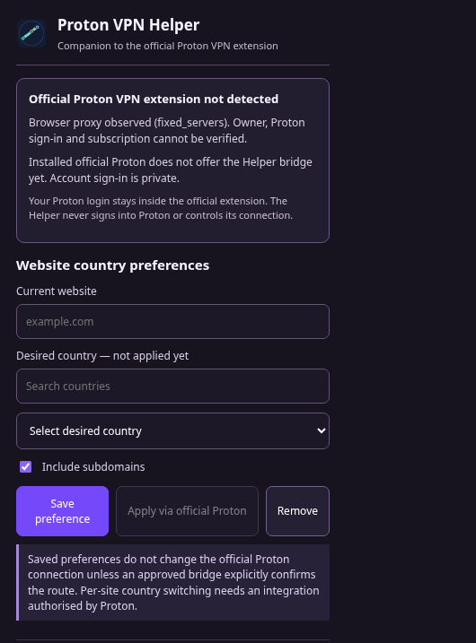

# Proton VPN Helper — official-connection companion

**Problem:** Proton VPN's browser extension lets you connect to a country and include or exclude websites, but it doesn't provide per-website *country* selection. Switching between countries by hand is cumbersome.

**Goal:** Let users save a country for each website and eventually automate those choices, **using only the official Proton VPN browser connection and account**. No second Proton login, no competing browser proxy.

## What works today (v1.4.1)

| Feature | Status |
| --- | --- |
| Detect whether the official Proton extension is installed and enabled | **Working**, via Chrome extension-management metadata |
| Observe whether a browser proxy is configured | **Working**, read-only; ownership and account sign-in cannot be proved |
| Monitor changes in browser proxy configuration | **Working**, locally at least once per minute |
| Save/remove desired countries for websites | **Working**, stored locally as **pending preferences** |
| Show original Proton flag artwork next to requested countries | **Working**; these are not account eligibility claims |
| Preserve old saved site preferences while disabling old VPN automation | **Working**, tested across a browser profile upgrade |
| Observe a public exit IP if the user explicitly requests it | **Optional**; not definitive proof of a Proton-owned exit |
| Read the official Proton account, paid subscription or eligible server list | **Not possible through the currently exposed interface** |
| Automatically change the official Proton country per website | **Not implemented**; requires Proton integration support |
| Send commands to the official Proton split-tunnelling controls | **Not implemented**; official extension does not authorise our extension |

**Important:** This is a companion, not a replacement VPN or a workaround for Chrome's extension isolation. Website country preferences **do not currently alter network traffic**. Continue connecting through the original Proton toolbar icon.



*Real automated-browser capture. The test uses a synthetic proxy owner and no Proton account; it is not a successful Proton VPN connection demonstration.*

## Install in Brave

This repo contains two different builds. **Use only `distribution-companion/` beside official Proton.** Do not load the older `distribution/` fork alongside your everyday VPN.

1. Build the companion: `python3 scripts/build_companion.py`.
2. Load its directory in Brave's unpacked-extension system. Existing Linux startup-flag installations can use `--load-extension=/absolute/path/to/distribution-companion` (combine multiple unpacked extensions in a single comma-separated flag).
3. **Completely restart Brave** for startup-flag changes to take effect. Pin **Proton VPN Helper** from the Extensions menu; its shortcut is **Alt+Shift+Y**.
4. Use the **official Proton VPN icon** to connect. Use the Helper icon to inspect the browser-proxy status and save preferred countries. These are not applied to your connection.

The companion retains the former Helper's public extension key, so it has the **same extension ID** when loaded from the new path. Existing pending preferences can be read, while Helper-only legacy Proton login sessions are wiped and automatic country-routing flags are forced off. **The official Proton extension's storage is never accessed or altered.**

## Proton-approved two-way bridge (implemented, not yet authorised upstream)

Version 1.4.1 includes the **client** side of a consent-gated protocol, and the Proton-derived source fork contains a **reference provider implementation** for upstream review. The Helper requests a `proton-vpn-helper/1` handshake against the *real* official Proton extension ID, validates a fresh challenge nonce, and only accepts a signed-in status if that extension explicitly reports user delegation. It can then request the subscription's non-secret country list; any country-routing command must be authorised by Proton's own routing engine.

Two-way `statusChanged` notifications are scoped to the official Proton extension ID. No sessions, passwords or proxy credentials are copied. Proton remains the only VPN connection owner.

**The official Proton version currently installed from the browser store does not expose this protocol.** Until Proton accepts the upstream integration, the Helper will report the bridge as unsupported; a successful login to official Proton **will not automatically mark the Helper as linked**. That is a deliberate security and accuracy guarantee.

We tested the complete handshake, explicit consent, account-status propagation, provider-supplied countries, authorised simulated route requests and revocation in headless Chromium with a **synthetic test-only provider**. This proves the protocol mechanics, not live Proton VPN connections. See [the upstream integration contract](docs/OFFICIAL_INTEGRATION_PROPOSAL.md).

## How it works

The separate companion lives under [`source/companion/`](source/companion). Its small service worker observes `chrome.proxy.settings.get()`, uses Chrome's management metadata to check that the official Proton extension is enabled, and stores local data-only preferences. It **never calls `chrome.proxy.settings.set()` or `clear()`**, never intercepts Proton proxy authentication, and never requests Proton login credentials.

It can optionally call `api.country.is` after you press the **Check observed exit IP** button. That service receives the request's public IP. A response identifies the observed country **only for that request**; it doesn't prove Proton account authentication, traffic ownership, DNS isolation or concurrent country-specific routing.

The native messaging bridge remains available to Rune MCP for synchronising **only non-secret site preferences**. It cannot ask the companion to change the official VPN.

## Tests

Run locally without opening desktop tabs:

```bash
python3 scripts/build_companion.py
node --experimental-default-type=module tests/companion_policy.mjs
node --experimental-default-type=module tests/official_bridge.mjs
python3 tests/companion_browser.py
python3 tests/companion_profile_upgrade.py
python3 tests/official_bridge_browser.py
```

The headless Chromium tests verify that a second extension's exact proxy endpoint stays untouched, old auto-route flags cannot re-enable routing, no Proton sign-in screen or onboarding tab opens, and the extension retains its ID while deleting its *own* old session records.

The prior modified-VPN fork and its synthetic proxy tests are retained for research, **not deployed as the companion**. See [legacy documentation](docs/LEGACY_FORK_README.md).

## What is needed for actual per-website countries

Proton would need to expose a specifically authorised, opt-in interface to the official extension. It should return non-secret connection and entitlement data, permit scoped routing requests, and implement the per-website transport in **Proton's own proxy engine**. The Helper would then issue instructions while Proton remains the sole VPN owner. See [proposed integration contract](docs/OFFICIAL_INTEGRATION_PROPOSAL.md).

**Proton VPN Helper is an unofficial open-source project.** Not affiliated with or endorsed by Proton AG. Original upstream source and artwork are used under the repository's GPLv3 licence.
