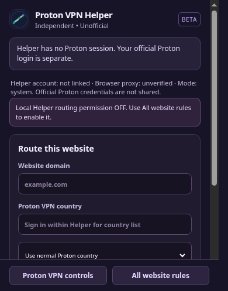

# Verifying Proton VPN Helper connections

This is a browser HTTPS-proxy extension, **not** a system-wide VPN tunnel. Proton's official browser extension uses browser HTTPS proxy connections. Any successful website-country rule must use the **authenticated Proton proxy**, not a direct request.

## What "connected" means

The Helper reports these conditions separately:

1. **Proton session present** — local Proton account state exists. This alone is not proof that the account/token is currently valid.
2. **Browser proxy connected** — Proton's connection state is ON, its proxy is enabled and Chromium reports that this extension owns a configured proxy. This is local client evidence, not an independently measured exit IP.
3. **External exit country observed** — when enabled by the user, an outbound request to `https://api.country.is/` returns an observed public IP and country. The Helper compares the country to the selected **default** Proton server country and records a timestamp in memory.

An IP country match is useful but not a conclusive Proton network ownership test, and it **does not prove all per-site rules, DNS, WebRTC, third-party resources or redirects are leak-free**.

## Always-on versus external checks

- **Automatic local monitoring** checks Proton session/proxy state when requested, on proxy changes, and via a Chromium alarm every minute while the browser is running. It does not contact any external IP-check service.
- **Check default VPN exit IP** is an optional user action. It is **disabled while disconnected** and refuses to run when the verification hostname could be excluded or overridden by site routing.
- **Check every five minutes** is optional and **off by default**. When enabled, the background monitor performs the same limited external check only while Proton reports an active VPN connection.
- IP evidence expires after **five minutes**. VPN connection changes invalidate it immediately. The raw request IP is kept only in extension memory, not synced to MCP.
- Country.is receives the public IP of each external verification request. We do not send Proton credentials, page content, browsing history, or the user's website-country rules to that service.

## Accurate country list

The Helper uses **the same `getSortedLogicals()` provider feed as Proton's own country picker**, with the same account-specific VPN tier. It reuses Proton's bundled flag SVGs (`source/img/flags`, displayed at 20×15 px) and the same country-name translation function.

When logged in and entitled, eligible countries are selectable. Countries restricted to higher tiers or unavailable appear disabled with their corresponding reason. There is no hard-coded country availability list.

**While signed out, no countries are declared available.** The UI asks the user to sign in through Proton's own controls. The following screenshot is a real headless Chromium capture of that signed-out state:

The screenshot is evidence of the status and sign-out safeguards, **not a successful Proton connection**.

## Release blocker: real authenticated proof

The current isolated development profile has not authenticated with Proton's account service. The modified extension has its own extension ID, and we do not copy the official Proton extension's private session or tokens.

To demonstrate a working Proton connection after the user signs in:

- Confirm the account entitlement and live Proton server catalogue load in the combined extension.
- Connect through Proton's own VPN control and confirm the browser proxy owner/mode.
- Run the explicit external IP/country check, compare the observed address to a known network baseline and the selected Proton server country, and record evidence without publishing private account details.
- Run controlled, headless tests showing **two different websites use different actual Proton exits**, while default traffic uses the selected main connection.
- Test DNS/WebRTC, third-party/CDN resources, redirects, disconnections, unsupported countries, and proxy conflicts for leak/fallback behaviour.

**Do not claim release readiness or production VPN protection until these pass.** Synthetic local TLS proxy tests validate PAC routing only.

References: [Proton browser extension limitations](https://protonvpn.com/support/browser-extension-limitations), [Proton's external-IP verification instructions](https://protonvpn.com/support/vpn-ip-change), [country.is](https://country.is/).

## Why your official Proton sign-in is not automatically discovered

Your signed-in official Proton browser extension and Proton VPN Helper have different extension IDs and separate storage. The installed official Proton extension's `externally_connectable` setting allows `https://account.proton.me/*` only, with **no allowed external extension IDs**. Browser extension messaging cannot be used to access its private sign-in state. The Helper must never claim the original Proton session is absent just because **its own** session is absent.

The current UI distinguishes **Helper session not linked**, **browser proxy owned by another extension**, and **Helper-connected with an unverified exit IP**. Observing another extension's proxy is not evidence of that extension's authenticated account or subscription, so do not infer those details from proxy settings. An official Proton integration API or a distinct user-approved Proton login is required for account-scoped country routing.
